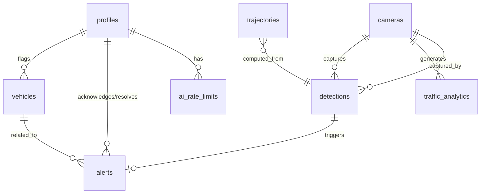

# CityPulse - Design Document

## 1. Summary

CityPulse is a city-wide AI-powered ANPR (Automatic Number Plate Recognition) platform designed for urban traffic authorities and law enforcement agencies. The system processes multi-camera feeds across a city network to provide three core capabilities: high-accuracy license plate recognition (>90% accuracy in diverse conditions), complete vehicle trajectory tracking across the city with spatial-temporal mapping, and comprehensive traffic analytics with real-time alerts for blacklisted vehicles and suspicious patterns. The platform enables city officials to query any vehicle's historical path, visualize traffic patterns through heatmaps and analytics dashboards, and receive instant alerts when high-interest vehicles are detected.

## 2. Architecture

```mermaid
graph TB
    subgraph "Client Layer"
        Web[Web Browser]
    end
    
    subgraph "Vercel - Next.js App Router"
        UI[React UI Components]
        Pages[App Routes]
        API[API Routes]
        Middleware[Auth Middleware]
    end
    
    subgraph "Supabase Backend"
        Auth[Supabase Auth]
        DB[(PostgreSQL + PostGIS)]
        Storage[File Storage]
        RLS[Row Level Security]
    end
    
    subgraph "AI Layer - Server Only"
        Gemini[Google Gemini API]
        AIRoute[/api/ai endpoint]
        Prompts[Prompt Templates]
        RateLimit[Rate Limiter]
    end
    
    subgraph "External Data"
        ANPR[ANPR Camera Feeds]
        GIS[GIS/Map Data]
    end
    
    Web --> UI
    UI --> Pages
    Pages --> Middleware
    Middleware --> Auth
    Pages --> API
    API --> DB
    API --> AIRoute
    AIRoute --> RateLimit
    AIRoute --> Gemini
    AIRoute --> Prompts
    DB --> RLS
    ANPR -.->|Manual Upload/API| API
    GIS -.->|Integration| Pages
    
    style Gemini fill:#f9f,stroke:#333,stroke-width:2px
    style AIRoute fill:#fcc,stroke:#333,stroke-width:2px
    style RLS fill:#cfc,stroke:#333,stroke-width:2px
```

## 3. Database Schema

### Tables

#### `profiles`
User profile information linked to Supabase auth.

| Column | Type | Constraints | Description |
|--------|------|-------------|-------------|
| id | uuid | PRIMARY KEY | References auth.users(id) |
| email | text | NOT NULL | User email |
| full_name | text | | User's full name |
| role | text | NOT NULL, DEFAULT 'operator' | 'admin', 'analyst', 'operator' |
| department | text | | Department/division |
| created_at | timestamptz | DEFAULT now() | Account creation |
| updated_at | timestamptz | DEFAULT now() | Last profile update |

**RLS Policy:**
- Users can read their own profile
- Admins can read all profiles
- Users can update only their own profile
- Only admins can update user roles

---

#### `cameras`
ANPR camera locations and metadata.

| Column | Type | Constraints | Description |
|--------|------|-------------|-------------|
| id | uuid | PRIMARY KEY, DEFAULT gen_random_uuid() | Camera ID |
| camera_code | text | UNIQUE, NOT NULL | Human-readable code (e.g., "CAM-001") |
| name | text | NOT NULL | Camera location name |
| location | geography(Point, 4326) | NOT NULL | GPS coordinates (PostGIS) |
| address | text | | Street address |
| direction | text | | Traffic direction (N/S/E/W) |
| status | text | DEFAULT 'active' | 'active', 'inactive', 'maintenance' |
| installation_date | date | | When installed |
| created_at | timestamptz | DEFAULT now() | |
| updated_at | timestamptz | DEFAULT now() | |

**RLS Policy:**
- All authenticated users can read cameras
- Only admins can insert, update, or delete cameras

---

#### `detections`
Individual ANPR detections from cameras.

| Column | Type | Constraints | Description |
|--------|------|-------------|-------------|
| id | uuid | PRIMARY KEY, DEFAULT gen_random_uuid() | Detection ID |
| camera_id | uuid | FOREIGN KEY → cameras(id), NOT NULL | Camera that made detection |
| plate_number | text | NOT NULL, INDEXED | Detected license plate |
| confidence | decimal(5,2) | CHECK (confidence >= 0 AND confidence <= 100) | OCR confidence (0-100%) |
| timestamp | timestamptz | NOT NULL, INDEXED | Detection time |
| image_url | text | | URL to detection image (if stored) |
| vehicle_type | text | | 'car', 'truck', 'motorcycle', 'bus', etc. |
| direction | text | | Direction of travel |
| speed | decimal(5,2) | | Speed in km/h (if available) |
| metadata | jsonb | | Additional data (color, make, etc.) |
| created_at | timestamptz | DEFAULT now() | |

**Indexes:**
- `idx_detections_plate` on `plate_number`
- `idx_detections_timestamp` on `timestamp`
- `idx_detections_camera_timestamp` on `(camera_id, timestamp)`

**RLS Policy:**
- All authenticated users can read detections
- Only admins and operators can insert detections
- No updates or deletes allowed (audit trail)

---

#### `vehicles`
Vehicle registry and watch list.

| Column | Type | Constraints | Description |
|--------|------|-------------|-------------|
| id | uuid | PRIMARY KEY, DEFAULT gen_random_uuid() | Vehicle ID |
| plate_number | text | UNIQUE, NOT NULL | License plate |
| owner_name | text | | Vehicle owner |
| vehicle_type | text | | Type of vehicle |
| make | text | | Manufacturer |
| model | text | | Model name |
| color | text | | Vehicle color |
| status | text | DEFAULT 'normal' | 'normal', 'watchlist', 'blacklist' |
| notes | text | | Additional notes |
| flagged_reason | text | | Reason if on watchlist/blacklist |
| flagged_at | timestamptz | | When flagged |
| flagged_by | uuid | FOREIGN KEY → profiles(id) | Who flagged |
| created_at | timestamptz | DEFAULT now() | |
| updated_at | timestamptz | DEFAULT now() | |

**RLS Policy:**
- All authenticated users can read vehicles
- Only admins and analysts can insert or update vehicles
- No deletes allowed (audit trail)

---

#### `trajectories`
Pre-computed vehicle trajectories for efficient querying.

| Column | Type | Constraints | Description |
|--------|------|-------------|-------------|
| id | uuid | PRIMARY KEY, DEFAULT gen_random_uuid() | Trajectory ID |
| plate_number | text | NOT NULL, INDEXED | License plate |
| start_time | timestamptz | NOT NULL | Journey start |
| end_time | timestamptz | NOT NULL | Journey end |
| path | jsonb | NOT NULL | Array of {camera_id, timestamp, location} |
| distance_km | decimal(10,2) | | Total distance |
| duration_minutes | decimal(10,2) | | Total duration |
| route_type | text | | 'commute', 'irregular', 'suspicious' |
| created_at | timestamptz | DEFAULT now() | |

**Indexes:**
- `idx_trajectories_plate` on `plate_number`
- `idx_trajectories_time` on `start_time, end_time`

**RLS Policy:**
- All authenticated users can read trajectories
- System-generated only (no direct inserts by users)

---

#### `alerts`
Real-time alerts for flagged vehicles and anomalies.

| Column | Type | Constraints | Description |
|--------|------|-------------|-------------|
| id | uuid | PRIMARY KEY, DEFAULT gen_random_uuid() | Alert ID |
| detection_id | uuid | FOREIGN KEY → detections(id), NOT NULL | Related detection |
| vehicle_id | uuid | FOREIGN KEY → vehicles(id) | Related vehicle (if known) |
| alert_type | text | NOT NULL | 'blacklist', 'suspicious_route', 'speed', 'stolen' |
| severity | text | DEFAULT 'medium' | 'low', 'medium', 'high', 'critical' |
| message | text | NOT NULL | Alert description |
| status | text | DEFAULT 'open' | 'open', 'acknowledged', 'resolved', 'false_positive' |
| acknowledged_by | uuid | FOREIGN KEY → profiles(id) | Who acknowledged |
| acknowledged_at | timestamptz | | When acknowledged |
| resolved_by | uuid | FOREIGN KEY → profiles(id) | Who resolved |
| resolved_at | timestamptz | | When resolved |
| notes | text | | Resolution notes |
| created_at | timestamptz | DEFAULT now() | |

**RLS Policy:**
- All authenticated users can read alerts
- Only operators and admins can acknowledge/resolve alerts
- System can create alerts automatically

---

#### `traffic_analytics`
Aggregated traffic statistics for dashboard.

| Column | Type | Constraints | Description |
|--------|------|-------------|-------------|
| id | uuid | PRIMARY KEY, DEFAULT gen_random_uuid() | Analytics ID |
| camera_id | uuid | FOREIGN KEY → cameras(id) | Camera location |
| time_bucket | timestamptz | NOT NULL | Time period (hourly) |
| vehicle_count | integer | DEFAULT 0 | Total vehicles |
| avg_speed | decimal(5,2) | | Average speed |
| congestion_level | text | | 'low', 'medium', 'high' |
| unique_plates | integer | DEFAULT 0 | Unique vehicles |
| metadata | jsonb | | Additional stats |
| created_at | timestamptz | DEFAULT now() | |

**Indexes:**
- `idx_analytics_camera_time` on `(camera_id, time_bucket)`

**RLS Policy:**
- All authenticated users can read analytics
- System-generated only

---

#### `ai_rate_limits`
Per-user AI request rate limiting.

| Column | Type | Constraints | Description |
|--------|------|-------------|-------------|
| id | uuid | PRIMARY KEY, DEFAULT gen_random_uuid() | Rate limit ID |
| user_id | uuid | FOREIGN KEY → profiles(id), NOT NULL | User |
| request_count | integer | DEFAULT 0 | Requests in current window |
| window_start | timestamptz | NOT NULL | Rate limit window start |
| last_request_at | timestamptz | | Last request time |
| created_at | timestamptz | DEFAULT now() | |
| updated_at | timestamptz | DEFAULT now() | |

**Unique Constraint:** `(user_id, window_start)`

**RLS Policy:**
- Users can read their own rate limit status
- System manages rate limit updates

---

### Database Relationships



---

## 4. Server Routes (API)

### Authentication Routes
Built-in Supabase Auth (email/password).

---

### `/api/detections`

**GET** - List detections with filters
- **Input (query params):**
  ```typescript
  {
    plate_number?: string,
    camera_id?: string,
    start_date?: string (ISO),
    end_date?: string (ISO),
    limit?: number,
    offset?: number
  }
  ```
- **Output:**
  ```typescript
  {
    detections: Detection[],
    total: number,
    page: number
  }
  ```
- **Auth:** Required (all authenticated users)

**POST** - Create new detection
- **Input:**
  ```typescript
  {
    camera_id: string (uuid),
    plate_number: string,
    confidence: number,
    timestamp: string (ISO),
    image_url?: string,
    vehicle_type?: string,
    direction?: string,
    speed?: number,
    metadata?: object
  }
  ```
- **Output:**
  ```typescript
  { detection: Detection, alert?: Alert }
  ```
- **Auth:** Required (operator, admin)

---

### `/api/vehicles`

**GET** - List vehicles
- **Input (query params):**
  ```typescript
  {
    plate_number?: string,
    status?: 'normal' | 'watchlist' | 'blacklist',
    search?: string
  }
  ```
- **Output:**
  ```typescript
  { vehicles: Vehicle[] }
  ```
- **Auth:** Required (all authenticated users)

**POST** - Add vehicle
- **Input:**
  ```typescript
  {
    plate_number: string,
    owner_name?: string,
    vehicle_type?: string,
    make?: string,
    model?: string,
    color?: string,
    status?: string,
    notes?: string
  }
  ```
- **Output:**
  ```typescript
  { vehicle: Vehicle }
  ```
- **Auth:** Required (analyst, admin)

**PATCH** `/api/vehicles/:id` - Update vehicle (flag/unflag)
- **Input:**
  ```typescript
  {
    status?: string,
    flagged_reason?: string,
    notes?: string
  }
  ```
- **Output:**
  ```typescript
  { vehicle: Vehicle }
  ```
- **Auth:** Required (analyst, admin)

---

### `/api/trajectories`

**GET** `/api/trajectories/:plate_number` - Get vehicle trajectory
- **Input (query params):**
  ```typescript
  {
    start_date?: string (ISO),
    end_date?: string (ISO)
  }
  ```
- **Output:**
  ```typescript
  {
    plate_number: string,
    trajectories: Trajectory[],
    detections: Detection[]
  }
  ```
- **Auth:** Required (all authenticated users)

**POST** `/api/trajectories/compute` - Compute trajectory for a plate
- **Input:**
  ```typescript
  {
    plate_number: string,
    start_date: string (ISO),
    end_date: string (ISO)
  }
  ```
- **Output:**
  ```typescript
  { trajectory: Trajectory }
  ```
- **Auth:** Required (analyst, admin)

---

### `/api/alerts`

**GET** - List alerts
- **Input (query params):**
  ```typescript
  {
    status?: 'open' | 'acknowledged' | 'resolved',
    severity?: 'low' | 'medium' | 'high' | 'critical',
    alert_type?: string
  }
  ```
- **Output:**
  ```typescript
  { alerts: Alert[] }
  ```
- **Auth:** Required (all authenticated users)

**PATCH** `/api/alerts/:id` - Acknowledge/resolve alert
- **Input:**
  ```typescript
  {
    status: 'acknowledged' | 'resolved' | 'false_positive',
    notes?: string
  }
  ```
- **Output:**
  ```typescript
  { alert: Alert }
  ```
- **Auth:** Required (operator, admin)

---

### `/api/analytics/traffic`

**GET** - Get traffic analytics
- **Input (query params):**
  ```typescript
  {
    camera_id?: string,
    start_date: string (ISO),
    end_date: string (ISO),
    granularity?: 'hour' | 'day'
  }
  ```
- **Output:**
  ```typescript
  {
    analytics: TrafficAnalytic[],
    summary: {
      total_vehicles: number,
      avg_speed: number,
      peak_hour: string
    }
  }
  ```
- **Auth:** Required (all authenticated users)

---

### `/api/analytics/heatmap`

**GET** - Get traffic heatmap data
- **Input (query params):**
  ```typescript
  {
    start_date: string (ISO),
    end_date: string (ISO)
  }
  ```
- **Output:**
  ```typescript
  {
    heatmap: Array<{
      camera_id: string,
      location: { lat: number, lng: number },
      intensity: number,
      vehicle_count: number
    }>
  }
  ```
- **Auth:** Required (all authenticated users)

---

### `/api/ai`

**POST** - AI analysis endpoint
- **Input:**
  ```typescript
  {
    action: 'analyze_pattern' | 'predict_route' | 'summarize_behavior' | 'detect_anomaly',
    data: {
      plate_number?: string,
      detections?: Detection[],
      trajectories?: Trajectory[],
      context?: string
    }
  }
  ```
- **Output:**
  ```typescript
  {
    result: string | object,
    confidence?: number,
    processing_time_ms: number
  }
  ```
- **Error (429):**
  ```typescript
  {
    error: 'Rate limit exceeded',
    message: 'You have reached your AI request limit. Please try again later.',
    retry_after: number (seconds)
  }
  ```
- **Auth:** Required (all authenticated users)
- **Rate Limit:** 50 requests per user per hour

---

## 5. Pages and Components

### Pages (App Router)

#### `/` - Home/Dashboard
**Purpose:** Overview of system status and quick stats  
**Components:**
- `StatsCards` - Total detections, active alerts, cameras online
- `RecentAlerts` - List of recent/active alerts
- `LiveFeed` - Recent detections in real-time
- `QuickSearch` - Search bar for plate lookup

#### `/login` - Login Page
**Purpose:** User authentication  
**Components:**
- `LoginForm` - Email/password login form
- Supabase Auth integration

#### `/dashboard/detections` - Detections View
**Purpose:** Browse and filter all ANPR detections  
**Components:**
- `DetectionFilters` - Filter by date, camera, plate
- `DetectionTable` - Paginated table of detections
- `DetectionDetails` - Modal with full detection info

#### `/dashboard/vehicles` - Vehicle Registry
**Purpose:** Manage vehicles and watch lists  
**Components:**
- `VehicleSearch` - Search vehicles
- `VehicleTable` - List of vehicles with status badges
- `VehicleForm` - Add/edit vehicle details
- `FlagVehicleModal` - Add to watchlist/blacklist

#### `/dashboard/trajectory/:plate` - Vehicle Trajectory
**Purpose:** View complete travel history of a vehicle  
**Components:**
- `TrajectoryMap` - Interactive map with route
- `TrajectoryTimeline` - Chronological detection list
- `TrajectoryStats` - Distance, duration, speed stats
- `AIInsights` - AI-generated pattern analysis

#### `/dashboard/alerts` - Alerts Management
**Purpose:** Monitor and respond to alerts  
**Components:**
- `AlertFilters` - Filter by status, severity, type
- `AlertList` - List of alerts with priority indicators
- `AlertDetails` - Full alert information
- `AlertActions` - Acknowledge/resolve buttons

#### `/dashboard/analytics` - Traffic Analytics
**Purpose:** Traffic insights and visualizations  
**Components:**
- `HeatmapView` - GIS-based traffic heatmap
- `CameraAnalytics` - Per-camera statistics
- `TimeSeriesChart` - Traffic trends over time
- `CongestionsMap` - Real-time congestion indicators

#### `/dashboard/cameras` - Camera Management
**Purpose:** Manage ANPR camera network  
**Components:**
- `CameraMap` - Map view of all cameras
- `CameraList` - Table of cameras with status
- `CameraForm` - Add/edit camera details
- `CameraStatus` - Live status indicators

#### `/dashboard/settings` - Settings
**Purpose:** User profile and preferences  
**Components:**
- `ProfileForm` - Edit user profile
- `NotificationSettings` - Alert preferences
- `APIUsage` - AI rate limit status

---

## 6. AI Integration (Gemini API - Server-Side Only)

### Where AI is Used

#### 1. Trajectory Pattern Analysis
**Endpoint:** `/api/ai` with `action: 'analyze_pattern'`  
**Input:** Vehicle's detection history and trajectory data  
**Prompt Template:**
```
Analyze the following vehicle movement pattern:
Plate: {plate_number}
Detections: {detection_count}
Time period: {start_date} to {end_date}
Route data: {trajectory_json}

Identify:
1. Regular patterns (commute routes, frequent locations)
2. Any unusual behavior or route deviations
3. Time patterns (day/night, weekday/weekend)
4. Risk assessment (normal, monitor, suspicious)

Provide a brief summary in JSON format.
```
**Output:** Pattern analysis with risk level  
**Fallback:** Return basic statistics without AI interpretation

#### 2. Anomaly Detection
**Endpoint:** `/api/ai` with `action: 'detect_anomaly'`  
**Input:** Recent trajectory compared to historical patterns  
**Prompt Template:**
```
Vehicle {plate_number} has the following movement history:

Normal pattern: {historical_summary}
Current route: {current_trajectory}
Time: {timestamp}

Does this current route deviate significantly from the normal pattern?
Consider: unusual time, unexpected location, route complexity.

Respond with JSON: {is_anomalous: boolean, reason: string, confidence: number}
```
**Output:** Anomaly detection result  
**Fallback:** Rule-based anomaly detection (distance from usual routes)

#### 3. Behavior Summarization
**Endpoint:** `/api/ai` with `action: 'summarize_behavior'`  
**Input:** Long-term vehicle activity data  
**Prompt Template:**
```
Summarize the behavior of vehicle {plate_number} based on this data:
- Total detections: {count}
- Active period: {days} days
- Cameras visited: {camera_list}
- Peak activity times: {peak_times}
- Flagged incidents: {incidents}

Provide a 2-3 sentence natural language summary of this vehicle's typical behavior.
```
**Output:** Human-readable summary  
**Fallback:** Template-based summary

#### 4. Route Prediction
**Endpoint:** `/api/ai` with `action: 'predict_route'`  
**Input:** Vehicle's current location and historical routes  
**Prompt Template:**
```
Based on this vehicle's history:
Current location: {current_camera}
Time: {current_time}
Historical routes from this location: {route_history}

Predict the next 3 most likely cameras this vehicle will pass through.
Respond with JSON: {predictions: [{camera_id, probability}]}
```
**Output:** Predicted next cameras  
**Fallback:** Statistical most-common-next-camera

### AI Rate Limiting

- **Limit:** 50 requests per user per hour
- **Tracking:** `ai_rate_limits` table with sliding window
- **Response on limit:** HTTP 429 with friendly message and retry_after
- **Fallback:** When rate limited, return cached results or basic stats

### AI Failure Handling

- **Model unavailable:** Log error, return fallback result with `ai_available: false` flag
- **Timeout (>10s):** Cancel request, use fallback
- **Invalid response:** Parse error handling, return fallback
- **API key issues:** Alert admin, disable AI features gracefully

---

## 7. Build Order

### Module 1: Authentication & Database Foundation
**Description:** Set up Supabase auth, database schema, RLS policies, and seed data  
**Done when:** User can sign up, log in, and see their profile; all tables exist with RLS enabled

### Module 2: Camera Management
**Description:** CRUD for cameras with map view  
**Done when:** Admin can add a camera with GPS coordinates and see it on a map

### Module 3: Detection Ingestion
**Description:** API to receive and store ANPR detections  
**Done when:** POST to `/api/detections` saves a detection and shows in detections table

### Module 4: Vehicle Registry & Flagging
**Description:** Vehicle database with watchlist/blacklist functionality  
**Done when:** User can add a vehicle and flag it as blacklisted; flagged vehicle appears in registry

### Module 5: Real-Time Alerts
**Description:** Alert system that triggers when blacklisted vehicle is detected  
**Done when:** Detection of a blacklisted plate creates an alert visible on alerts page

### Module 6: Trajectory Tracking
**Description:** Query and reconstruct vehicle path across cameras  
**Done when:** Searching a plate number shows its complete route on a map with timestamps

### Module 7: Traffic Analytics Dashboard
**Description:** Aggregated statistics and heatmap visualization  
**Done when:** Analytics page shows vehicle counts per camera and a traffic heatmap

### Module 8: AI Layer - Pattern Analysis
**Description:** Gemini integration for trajectory pattern analysis  
**Done when:** Viewing a trajectory shows AI-generated insights about the vehicle's behavior

### Module 9: AI - Anomaly Detection
**Description:** Real-time anomaly detection for suspicious routes  
**Done when:** AI flags a vehicle taking an unusual route and creates a suspicious_route alert

### Module 10: Search & Filtering
**Description:** Advanced search across detections, vehicles, alerts  
**Done when:** User can search by plate, filter by date range, and export results

### Module 11: User Role Management
**Description:** Admin interface to manage users and roles  
**Done when:** Admin can view all users and change their roles (operator/analyst/admin)

### Module 12: Notifications & Alert Workflow
**Description:** Alert acknowledgment and resolution workflow  
**Done when:** User can acknowledge an alert, add notes, and mark it as resolved

---

## 8. Assumptions & Open Questions

### Assumptions Made

1. **ANPR Data Source:** We assume detections will be manually uploaded or ingested via API for the demo. No live camera feed integration is expected for SIH demo.

2. **Map Provider:** We will use OpenStreetMap/Leaflet or Mapbox for GIS visualization. No specific map provider was specified.

3. **OCR Accuracy:** The "high-accuracy ANPR engine" requirement will be simulated. We are building the platform that *would* receive OCR results, not implementing the OCR model itself (that's typically a separate computer vision system).

4. **Deployment Scale:** Initial deployment targets a city of ~100 cameras, ~10,000 detections/day. This is for demo purposes; the architecture is designed to scale.

5. **User Roles:** Three roles defined: 
   - `admin` - Full access
   - `analyst` - Can flag vehicles, manage watchlists
   - `operator` - Can view data, acknowledge alerts

6. **AI Model:** Using Google Gemini Flash (fast, cost-effective). Can swap to Groq later if needed.

7. **Rate Limiting:** 50 AI requests/user/hour is reasonable for demo. Production would need higher limits or tiered pricing.

8. **Real-Time:** "Real-time" alerts mean <5 seconds from detection to alert creation. True millisecond real-time is not required for demo.

9. **Image Storage:** Detection images are optional; URLs stored in DB but actual image hosting (Supabase Storage or CDN) is Phase 2.

10. **Mobile:** Responsive web UI (mobile-friendly), but no native mobile app for SIH demo.

### Open Questions & Unclear Points

1. **OCR Implementation:** The problem statement emphasizes ">90% OCR accuracy" but doesn't specify if we're building the OCR model or the platform that uses it. **Assumption:** We build the platform; OCR is a separate service/API that feeds us plate numbers.

2. **Camera Feed Format:** How are camera feeds ingested? API? File upload? Manual entry? **Assumption:** Manual upload and REST API for demo.

3. **GIS Integration:** What level of GIS detail is required? Street-level routing or just camera-to-camera paths? **Assumption:** Camera-to-camera is sufficient; street routing is nice-to-have.

4. **Alert Response:** What actions should operators take when an alert fires? Just acknowledge, or dispatch a unit? **Assumption:** Just acknowledge/resolve in the system; external dispatch is out of scope.

5. **Historical Data:** How much historical data should be in the seed? **Assumption:** 30 days of sample data for 50 cameras and 100 unique plates.

6. **Blacklist Source:** Where does the blacklist come from? Manual entry or external API? **Assumption:** Manual entry by admins/analysts.

7. **Vehicle Details:** How detailed should vehicle registry be? Just plate or full registration info? **Assumption:** Basic info (plate, owner, type, color) is sufficient.

8. **Trajectory Definition:** What defines a "trajectory"? Continuous movement within X hours or any detections of the same plate? **Assumption:** Detections within 24 hours with gaps <4 hours form one trajectory.

9. **Analytics Granularity:** Hourly, daily, weekly aggregates? **Assumption:** Hourly aggregates stored, UI can display daily/weekly views.

10. **Multi-City:** Is multi-city support needed? **Assumption:** No, single city for demo. Database schema allows expansion later.

### Potential Conflicts

- **Scope vs. Timeline:** The problem statement lists 4 major components (OCR, tracking, analytics, alerts). For a hackathon demo, we prioritize tracking + alerts + basic analytics. Full OCR implementation is out of scope.

- **"Real-Time" Definition:** Problem says "real-time alerts" but also wants historical trajectory reconstruction. **Resolution:** Real-time means immediate alert on detection; historical tracking is a separate query feature.

- **"City-Wide" Scale:** Problem implies large-scale deployment, but a hackathon demo can't deploy actual city infrastructure. **Resolution:** Simulated deployment with seed data proving the system *could* scale.
